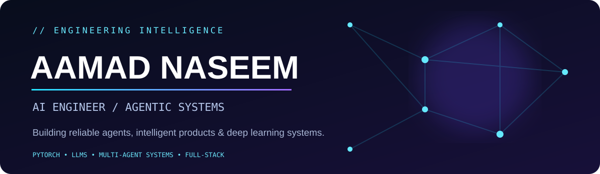

<div align="center">
  
  <br/><br/>
  
  <br/><br/>
  <a href="https://github.com/AmmadNaseem?tab=repositories"></a>
  <a href="https://www.linkedin.com/in/aamad-naseem/"></a>
</div>

<br/>

## `01 / ABOUT`

**AI Engineer · Agentic AI Builder · Deep Learning Researcher · Full-Stack Software Engineer**

I build intelligent applications at the intersection of **LLMs, autonomous agents, deep learning, and scalable software engineering**. With **5+ years in software development** and ongoing **MS AI Engineering** studies, I care about more than a successful demo: I focus on **structured outputs, verification, recovery, evaluation, and maintainable systems**.

> **Engineering principle:** Intelligence is valuable. Reliable intelligence is engineering.

- 🔭 **Building:** multi-agent workflows, AI-powered applications, and research prototypes.
- 🧠 **Research interests:** agentic AI reliability, deep learning, medical computer vision.
- ⚙️ **Engineering:** full-stack applications, APIs, integrations, accessibility, and production-oriented architecture.

## `02 / SELECTED WORK`

<table>
<tr><td width="50%" valign="top">
<h3>🛰️ BeeScribe</h3>
<b>Multi-Agent AI Content Pipeline</b><br/><br/>
SCOUT → READER → VERIFIER → WRITER → EDITOR → HUMANIZER.<br/><br/>
Focus: source verification, Pydantic contracts, fallback models, semantic checks, and output quality.
<br/><br/><code>Agentic AI</code> <code>LLMs</code> <code>Python</code>
</td><td width="50%" valign="top">
<h3>🧩 Questlume</h3>
<b>AI Interview Preparation Platform</b><br/><br/>
An AI-powered question and answer generation concept using uploaded documents and online information.<br/><br/>
Focus: retrieval, orchestration, and useful learning workflows.
<br/><br/><code>LangChain</code> <code>RAG</code> <code>LLMs</code>
</td></tr>
<tr><td width="50%" valign="top">
<h3>👁️ RetinaRoute-Net</h3>
<b>Diabetic Retinopathy Severity Research</b><br/><br/>
Five-class retinal disease grading research with EfficientNetV2-S, feature pyramids, and ordinal-learning components.<br/><br/>
Focus: minority-class performance and calibration.
<br/><br/><code>PyTorch</code> <code>Computer Vision</code>
</td><td width="50%" valign="top">
<h3>🌾 Weed &amp; Wheat Segmentation</h3>
<b>U-Net Semantic Segmentation</b><br/><br/>
Three-level U-Net for agricultural image segmentation.<br/><br/>
Research result: <b>87.50% mean Dice</b> on the evaluated test set.
<br/><br/><code>U-Net</code> <code>Deep Learning</code>
</td></tr>
</table>

> 🔗 **Repository links:** Add direct links to the corresponding public repositories once their exact names and visibility are confirmed. Project descriptions above are based on work in progress and research; they are not claims of deployed products.

## `03 / TECHNOLOGY ECOSYSTEM`

<div align="center">
<br/>

</div>

<br/>

| Focus | Technologies & practices |
|---|---|
| **Agentic AI** | LLM orchestration · multi-agent pipelines · RAG · structured validation · fallback strategies |
| **Deep Learning** | PyTorch · CNNs · segmentation · model evaluation · calibration |
| **Application Engineering** | Angular · TypeScript · .NET · C# · SQL · REST APIs |
| **Quality & Accessibility** | WCAG · Section 508 · testing · robust UX |

## `04 / ENGINEERING MINDSET`

```text
RESEARCH  →  PROTOTYPE  →  EVALUATE  →  VERIFY  →  HARDEN  →  SHIP
    \_____________________________________________________/
                 Reliable AI is a system property.
```

<h2>05 / GITHUB SIGNAL</h2>

<div align="center">

  

  

</div>

> Stats are generated by a third-party service and may occasionally fail to load. Language charts reflect repository code, not expertise.

## `06 / CONNECT`

<div align="center">
<a href="https://github.com/AmmadNaseem">GitHub</a> &nbsp;•&nbsp; <a href="https://www.linkedin.com/in/aamad-naseem/">LinkedIn</a>
<br/><br/>
<sub>⚡ Building AI that works beyond the demo.</sub>
</div>
